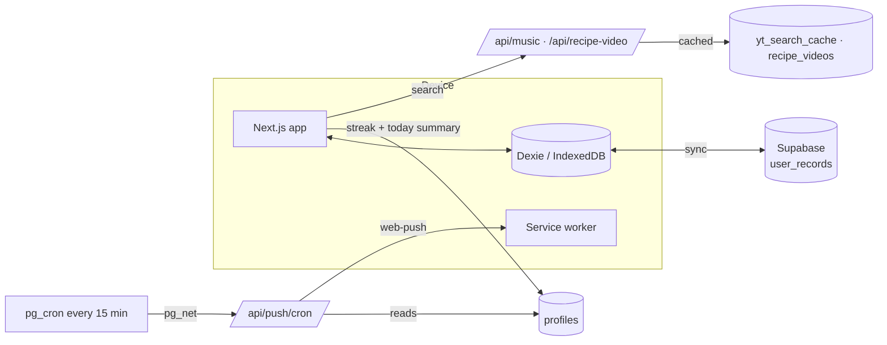

<div align="center">


# FitMate

**You made the plan. FitMate makes it easy to follow.**

Workouts, meals, form videos, music and reminders in one daily checklist, with streaks that keep you coming back and plans that get harder as you get stronger.

[Live app](https://fitmateapp.vercel.app) · [Features](#features) · [Getting started](#getting-started) · [How it works](#how-it-works)


</div>

---

## Features

### Today, in one place
- **Daily checklist**: today's workout and meals, ticked off as you go.
- **Streaks, Duolingo-style**: a living flame, a week chain, milestones, your own streak goal, and **streak freezes** (earn one every 7 days, hold up to 2) that save a missed day automatically.
- **Celebrations** when the day is done: confetti, a chime, the number flipping up.

### Workouts that progress
- **Progressive overload from your logs**: hit every set and the next session asks for +1 rep (holds +5 s). At the top of the range, weighted moves get heavier and bodyweight moves get an extra set.
- **4-week blocks** with a lighter week 4, and a **block review** with one tap to build the next block from your results.
- **In-session tools**: one-tap set logging, − / + for the reps you actually did, a rest timer that runs itself, a hold timer with 3-2-1 that stops and logs on time, and swaps for any exercise.
- **Form videos** for every move (YouTube, matched per exercise).

### A diet that adapts
- **Weekly menu rotation**: each meal cycles through its alternatives, but only ones that keep at least 90% of the protein and stay within 12% of the calories.
- **Gap tips**: after today's remaining meals, if calories, protein, carbs or fat are still short (or over), FitMate suggests foods sized to the gap, starting with foods already in your plan, and logs one in a tap.
- **Follows your weight**: a weekly weigh-in. If your trend is off for your goal, FitMate suggests ±150 kcal. Protein stays the same; carbs and fat are re-split.
- **Grocery lists** written by the AI in real shop sizes, one per rotated menu. Copy them or send them on WhatsApp.
- **Recipe videos**, ingredients and steps for every dish, plus the week ahead.

### AI plans, your AI
- Answer a few taps and FitMate writes a detailed prompt. You run it in ChatGPT, Claude, Gemini or Perplexity and paste the reply back.
- The prompt includes your targets, equipment, skills and bests, your training days, your last block's results, and rules for affordable, realistic meals.
- You can also import an existing plan (JSON or PDF).

### Reminders that sound human
- **Web push**:
  - The morning plan.
  - Each meal at its time, with a follow-up if it isn't logged.
  - Your workout: 30 minutes before, at your chosen time, and a follow-up if it isn't done.
  - Check-ins at 11 am and 4 pm.
  - An evening chain if the day isn't done yet: 8 pm, 9:30 pm, 10:30 pm, and 11:15 pm when there's a streak to save.
- **Sunday check-in**: a 9 am weigh-in plus grocery reminder.
- Every reminder **names the actual dish or workout**. No emojis, no spam: each reminder goes out at most once a day.

### Music while you train or cook
- Search any song. A song you pick keeps going into YouTube's mix of similar songs.
- Quick picks for the gym and the kitchen.
- A mini player you can minimise. It pauses for form videos, comes back after reloads, and dips the volume when rest ends.

### Built to feel like an app
- An installable PWA with pull to refresh, light, dark or system theme, and a full-screen intro on first open.
- **Offline-first**: everything works from the device and syncs to the cloud when it can.
- An **admin dashboard** for users, plans, feedback and broadcast notifications.

---

## Tech stack

| Layer | What |
|---|---|
| Framework | [Next.js 15](https://nextjs.org) (App Router, Turbopack), React 19 |
| Styling | Tailwind CSS 4, [lucide-react](https://lucide.dev) icons |
| On-device data | [Dexie](https://dexie.org) (IndexedDB), live queries |
| Cloud | [Supabase](https://supabase.com): Auth, Postgres with Row Level Security, pg_cron, pg_net, Vault |
| Push | Web Push (VAPID) via [`web-push`](https://github.com/web-push-libs/web-push) and a service worker |
| Media | YouTube Data API v3 (search results cached in Postgres), youtube-nocookie embeds |
| Email | [Brevo](https://brevo.com) (password reset codes) |
| PDF import | pdf.js |
| Hosting | [Vercel](https://vercel.com) |

---

## How it works



- **Offline-first sync.** Plans, logs and preferences live in IndexedDB. A sync engine pushes local changes and pulls remote ones from a single `user_records` table (collection, id, JSON). The server is the source of truth: the first sync after each app open is a full pull plus reconcile.
- **Reminders without a client.** The device reports a small summary to `profiles`: the streak, the week's plan (dish and workout names) and today's log. Every 15 minutes `pg_cron` calls `/api/push/cron` with a secret from Vault. The route works out what's due for each user in their own time zone, claims each reminder once per day (`notification_log`) and sends it with web-push.
- **YouTube within the free quota.** Searches are cached for 24 hours, and the number of new searches per day is capped. Only songs that are allowed to play outside YouTube are returned.

### The rules that keep it from being static

| What | Rule |
|---|---|
| Progressive overload | Hit every set → +1 rep (+5 s for holds), up to the plan's reps + 4. Then weighted: +2.5 kg and back to the plan's reps; bodyweight: +1 set. Missed reps → same target. |
| Blocks | 4 weeks from when the plan was created. Week 4 uses about 60% of the sets with no increases. |
| Menu rotation | Week 1 is the plan as written; weeks 2, 3, … use each meal's alternatives in turn, if they meet the goals. Your own swaps always win. |
| Weight adaptation | A straight-line trend through 3+ weigh-ins over 10+ days, checked against the goal's weekly range. Outside the range → ±150 kcal. At most one change per 14 days. |
| Gap tips | Today = eaten + meals still to eat. A gap shows only when it's more than 10% of the target and meaningful (for example 150 kcal or 8 g of protein). |

The code for these lives in `lib/workout/progression.js`, `lib/diet/rotation.js`, `lib/diet/adapt.js` and `lib/diet/gapTips.js`. All are small pure functions, easy to test.

---

## Getting started

### Prerequisites
- **Node.js 22+**
- A Supabase project (optional: without one, FitMate runs fully on the device)

### 1. Install

```bash
git clone https://github.com/sanskardev9/Fitmate.git
cd Fitmate
npm install
cp .env.example .env.local
```

### 2. Environment variables

| Variable | Where it's used | Required for |
|---|---|---|
| `NEXT_PUBLIC_SITE_URL` | Browser and server | Auth email links |
| `NEXT_PUBLIC_SUPABASE_URL` | Browser | Accounts and sync |
| `NEXT_PUBLIC_SUPABASE_PUBLISHABLE_KEY` | Browser (Row Level Security protects data) | Accounts and sync |
| `SUPABASE_SECRET_KEY` | **Server only** | Admin, reminders, caches |
| `NEXT_PUBLIC_VAPID_PUBLIC_KEY` | Browser | Push notifications |
| `VAPID_PRIVATE_KEY` | **Server only** | Push notifications |
| `CRON_SECRET` | **Server only** | The reminder job |
| `YOUTUBE_API_KEY` | **Server only** | Form, recipe and music videos |
| `BREVO_API_KEY`, `MAIL_FROM_EMAIL`, `MAIL_FROM_NAME` | **Server only** | Password reset emails |
| `SUPABASE_DB_URL` | Your machine only | Running migrations or SQL from a terminal |

Generate VAPID keys once:

```bash
npx web-push generate-vapid-keys
```

> Never prefix server-only values with `NEXT_PUBLIC_`, and never commit `.env.local`.

### 3. Database

Apply the SQL files in `supabase/migrations/` **in filename order**, using the Supabase SQL editor or the Supabase CLI:

```bash
supabase link --project-ref <your-project-ref>
supabase db push
```

Then, for reminders, store the cron secret in Vault (the same value as `CRON_SECRET`) and point the job at your deployment:

```sql
select vault.create_secret('<CRON_SECRET>', 'fitmate_cron_secret');
-- In 20261104123000_reminder_cron.sql, change the URL to https://<your-app>/api/push/cron
```

### 4. Run

```bash
npm run dev     # http://localhost:3000
```

| Script | What it does |
|---|---|
| `npm run dev` | Dev server (Turbopack) |
| `npm run build` | Production build |
| `npm start` | Serve the production build |
| `npm run lint` | ESLint |

---

## Project structure

```text
app/
  (dashboard)/        home, workout, diet, progress, plans, profile
  (admin)/            admin dashboard
  session/            the live workout
  streak/             streak calendar
  api/                push (subscribe, cron), music, recipe/exercise video, auth, admin
components/
  home/               today, streak card + celebration, check-in, block review
  workout/            workout page, live session, swaps, form videos, timers
  diet/               diet page, week ahead, grocery list, recipe video, add food
  tracker/            meals card (macro tiles, gap tips)
  music/              picker, mini player
  common/             AI create / import, theme, toasts, dialogs
lib/
  db/                 Dexie schema
  sync/               device ↔ Supabase sync
  services/           workouts, sessions, diet, streak, insights, profile
  workout/            progression, block review, rest timer, sections
  diet/               rotation, adaptation, gap tips, groceries
  server/             push, reminders (server only)
public/sw.js          service worker (push, actions, snooze)
supabase/migrations/  SQL, in order
```

---

## Deployment

FitMate deploys on **Vercel**:

1. Import the repo and add the environment variables above (Production and Preview).
2. Branches:
   - `main` is production.
   - `development` is for work in progress and gets preview deployments.
3. After the first deploy, update the reminder job's URL (see [Database](#3-database)) if your domain differs.

---

## Security

- **Row Level Security** on every table in the exposed schema: users only ever read and write their own rows.
- **Server-only secrets:** the secret key, VAPID private key, cron secret, YouTube and Brevo keys are used only in route handlers and `lib/server/*`, which import `server-only`.
- **Cron authentication:** the cron endpoint requires a bearer secret stored in Supabase Vault, never in git.

---

## Contributing

1. Branch from `development`.
2. Keep functions small and logic in `lib/` (pure where possible).
3. Run `npm run lint` and `npm run build` before opening a PR into `development`.

<div align="center">

**Show up every day. That's the whole secret.**

</div>
